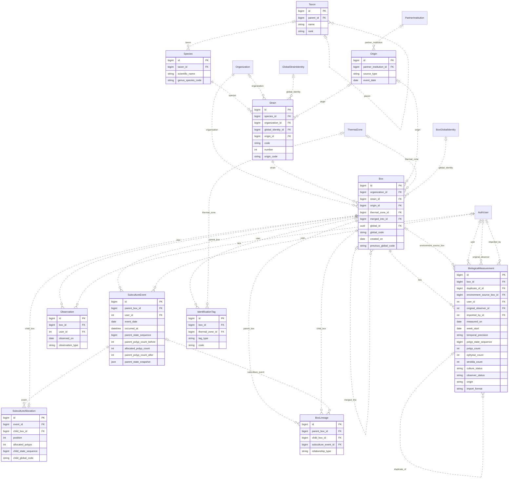
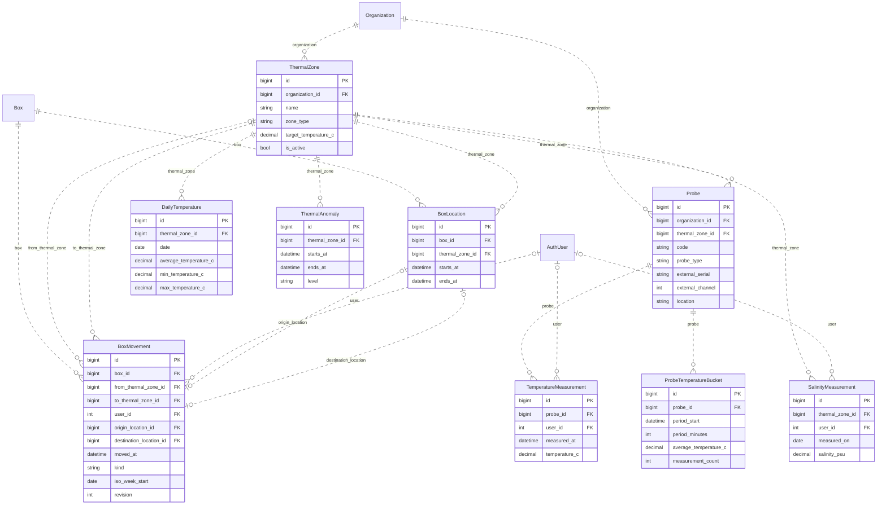
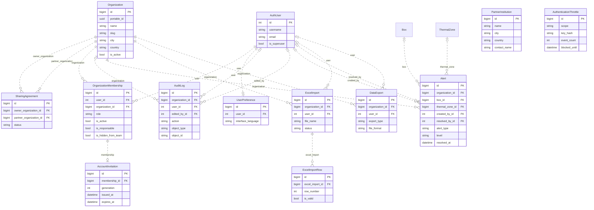
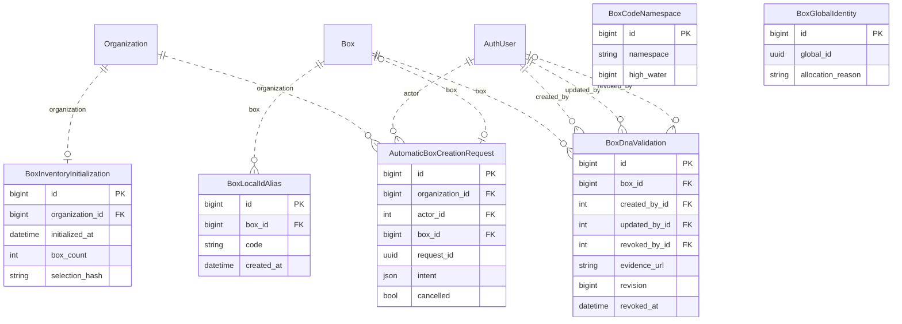
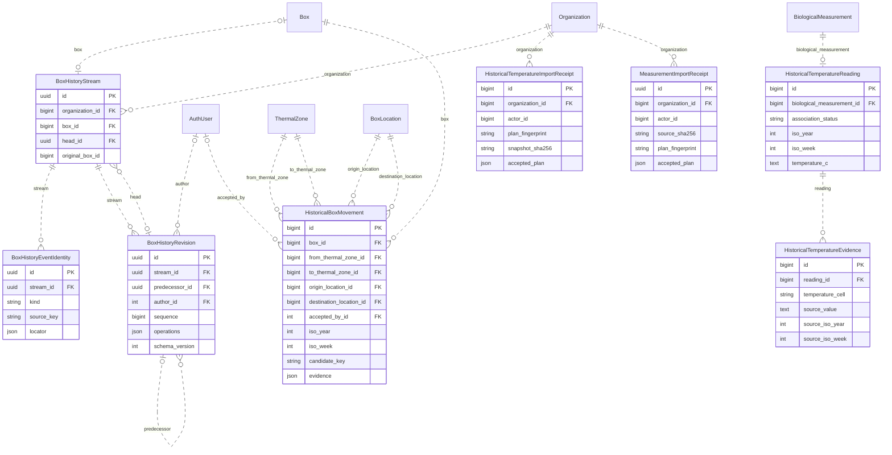
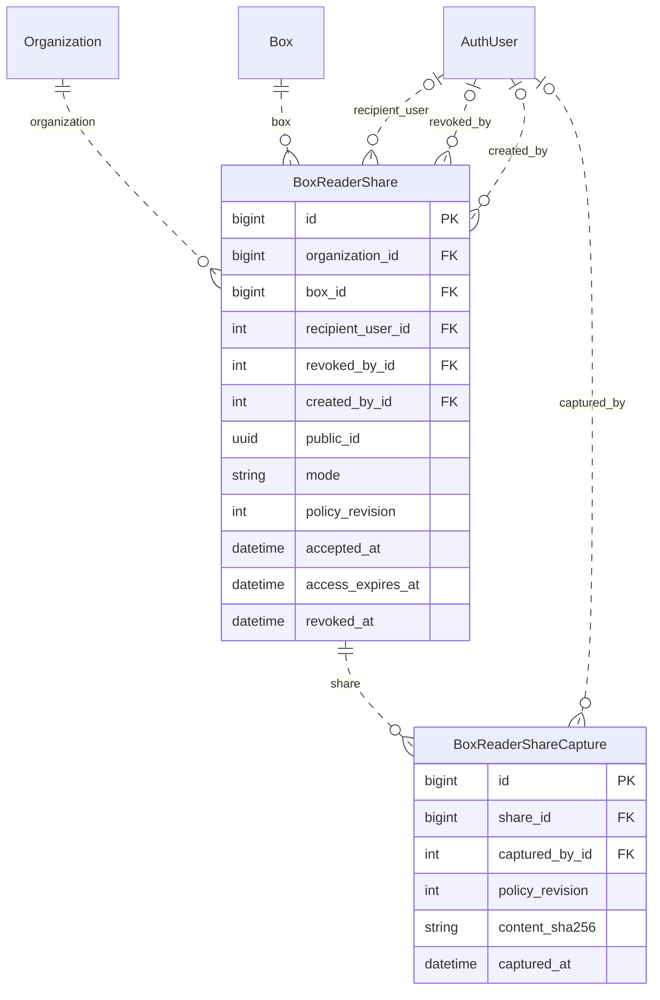

# Schéma de la base de données POLYPBASE — modèles Django

Inventaire PR3 : **68 modèles concrets propres au projet**, dont **38 nouvellement dessinés**.
Les trois domaines des MCD validés (métier, environnement, gestion) servent de
point de départ. Les diagrammes couvrent aussi les extensions du code, sans
modifier les MCD historiques ni attester le schéma déployé.

| Application Django | Modèles |
|---|---:|
| `accounts` | 4 |
| `audit` | 2 |
| `cultures` | 27 |
| `exports` | 3 |
| `measurements` | 12 |
| `organizations` | 3 |
| `sharing` | 2 |
| `taxonomy` | 15 |
| **Total** | **68** |

Source : registre des applications `apps.*`, chargé avec `config.preflight_settings`
(SQLite `:memory:`, dotenv neutralisé, aucune connexion ouverte). Sont exclus les
modèles abstraits, proxys et modèles générés automatiquement. `AuthUser` représente
**`auth.User`**, le modèle utilisateur fourni par Django (`AUTH_USER_MODEL`),
affiché comme cible externe et exclu du total.

**Lecture :** chaque modèle a un bloc d’attributs dans un seul diagramme. Un nœud
sans attributs renvoie à son bloc dans un autre diagramme. Les champs non
relationnels sont sélectifs. Les liens FK et OneToOne vont du modèle référencé
vers le modèle porteur, avec le nom du champ Django sur le lien et le nom de la
colonne SQL dans le bloc. Les cardinalités décrivent la nullabilité et l’unicité
du champ seul, pas les contraintes conditionnelles, composites ou métier.
`PK` = clé primaire ; `FK` = clé étrangère.

## 1. Métier : souches, boîtes et suivi biologique

Les rôles `box` et `environment_source_box` d’un relevé sont distincts.
`IdentificationTag` a deux FK nullables ; `identification_tag_targets_one_object`
impose exactement une cible, boîte ou zone.



## 2. Environnement : zones, sondes et mesures

`BoxMovement` distingue zones de départ et d’arrivée et périodes d’emplacement
associées. `Probe.thermal_zone` décrit seulement l’affectation courante.



## 3. Gestion : institutions, comptes, audit et fichiers

`Alert` représente le stockage historique dormant, pas une fonctionnalité
active. `AuditLog` et Actions restent actifs ; `AuditLog.object_id` n’est pas une FK.



## 4. Référentiels institutionnels et identités de souche

`InstitutionSpecies` référence l’espèce partagée, mais n’est pas la cible de
`Strain.species`. `LocalStrainIdentity` référence les affectations AAA/BBB par
leurs FK, pas par des copies de codes.

```mermaid
erDiagram
    Species ||..o{ SpeciesTranslation : "species"
    Strain ||..o{ StrainTranslation : "strain"
    Organization ||..o{ InstitutionSpecies : "organization"
    Species ||..o{ InstitutionSpecies : "species"
    Organization ||..o{ InstitutionStrainCreationRequest : "organization"
    AuthUser ||..o{ InstitutionStrainCreationRequest : "actor"
    Strain ||..o| InstitutionStrainCreationRequest : "strain"
    Organization ||..o{ SpeciesCodeChangeRequest : "organization"
    AuthUser ||..o{ SpeciesCodeChangeRequest : "actor"
    InstitutionSpecies ||..o{ SpeciesCodeChangeRequest : "profile"
    Organization ||..o{ OrganizationSpeciesCode : "organization"
    Species ||..o{ OrganizationSpeciesCode : "species"
    Organization ||..o{ OrganizationProvenanceCode : "organization"
    BiologicalProvenance ||..o{ OrganizationProvenanceCode : "biological_provenance"
    Strain ||..o| LocalStrainIdentity : "strain"
    OrganizationSpeciesCode ||..o{ LocalStrainIdentity : "species_code_assignment"
    OrganizationProvenanceCode |o..o{ LocalStrainIdentity : "provenance_code_assignment"
    Organization ||..o{ LocalStrainNumberCounter : "organization"
    Species ||..o{ LocalStrainNumberCounter : "species"
    BiologicalProvenance |o..o{ LocalStrainNumberCounter : "biological_provenance"

    SpeciesTranslation {
        bigint id PK
        bigint species_id FK
        string language_code
        string name
    }
    StrainTranslation {
        bigint id PK
        bigint strain_id FK
        string language_code
        string name
    }
    InstitutionSpecies {
        bigint id PK
        bigint organization_id FK
        bigint species_id FK
        string scientific_name
        int worms_aphia_id
        bigint revision
    }
    InstitutionStrainCreationRequest {
        bigint id PK
        bigint organization_id FK
        int actor_id FK
        bigint strain_id FK
        uuid request_id
        json intent
    }
    SpeciesCodeChangeRequest {
        bigint id PK
        bigint organization_id FK
        int actor_id FK
        bigint profile_id FK
        uuid request_id
        json intent
        json result
    }
    BiologicalProvenance {
        bigint id PK
        string name
    }
    GlobalStrainIdentity {
        bigint id PK
        uuid global_id
    }
    OrganizationSpeciesCode {
        bigint id PK
        bigint organization_id FK
        bigint species_id FK
        string code
    }
    OrganizationProvenanceCode {
        bigint id PK
        bigint organization_id FK
        bigint biological_provenance_id FK
        string code
        string country_code
    }
    LocalStrainIdentity {
        bigint id PK
        bigint strain_id FK
        bigint species_code_assignment_id FK
        bigint provenance_code_assignment_id FK
    }
    LocalStrainNumberCounter {
        bigint id PK
        bigint organization_id FK
        bigint species_id FK
        bigint biological_provenance_id FK
        int last_number
    }
```



## 5. Création, identification et inventaire des boîtes

`Box.global_identity` cible `BoxGlobalIdentity.global_id` (UUID, colonne
`global_id` sur `Box`), pas la PK ni `GlobalBoxIdentity`. `Box.merged_into`
cible une autre ligne `Box`. `BoxCodeNamespace` n’a pas de FK vers les boîtes
qu’il aide à numéroter.



## 6. Transferts, lignée portable et propriété

`GlobalBoxIdentity` est distinct de `BoxGlobalIdentity` : il est référencé par
les épisodes de propriété et les propositions de don. La boîte locale d’un
épisode est reliée par `local_box` (OneToOne). Les UUID de provenance `arrival_*`,
`PortableLineageEdge.transfer_id` / `item_id` et les identifiants institutionnels
de l’enveloppe ne sont pas des FK. Les liaisons `local_box` et `local_lineage` du
graphe portable sont facultatives.

```mermaid
erDiagram
    Box ||..o{ BoxTransfer : "box"
    Organization ||..o{ BoxTransfer : "from_organization"
    Organization ||..o{ BoxTransfer : "to_organization"
    AuthUser |o..o{ BoxTransfer : "user"
    Organization ||..o{ BoxTransferImport : "destination_organization"
    Box ||..o| BoxTransferImport : "created_box"
    AuthUser |o..o{ BoxTransferImport : "imported_by"
    Organization ||..o{ TransferEnvelope : "source_organization"
    AuthUser |o..o{ TransferEnvelope : "created_by"
    TransferEnvelope ||..o{ TransferItem : "envelope"
    Box ||..o{ TransferItem : "source_box"
    Organization ||..o{ PortableLineageNode : "organization"
    Box |o..o| PortableLineageNode : "local_box"
    Organization ||..o{ PortableLineageEdge : "organization"
    PortableLineageNode ||..o{ PortableLineageEdge : "source_node"
    PortableLineageNode ||..o{ PortableLineageEdge : "target_node"
    BoxLineage |o..o| PortableLineageEdge : "local_lineage"
    GlobalBoxIdentity ||..o{ BoxOwnershipEpisode : "identity"
    Organization ||..o{ BoxOwnershipEpisode : "organization"
    Box ||..o| BoxOwnershipEpisode : "local_box"
    Organization ||..o{ BoxDonationProposal : "source_organization"
    Organization ||..o{ BoxDonationProposal : "destination_organization"
    Box ||..o{ BoxDonationProposal : "source_box"
    GlobalBoxIdentity ||..o{ BoxDonationProposal : "identity"
    BoxOwnershipEpisode ||..o{ BoxDonationProposal : "source_episode"
    AuthUser ||..o{ BoxDonationProposal : "history_verified_by"
    AuthUser ||..o{ BoxDonationProposal : "created_by"
    AuthUser |o..o{ BoxDonationProposal : "cancelled_by"

    BoxTransfer {
        bigint id PK
        bigint box_id FK
        bigint from_organization_id FK
        bigint to_organization_id FK
        int user_id FK
        date transfer_date
        string status
    }
    BoxTransferImport {
        bigint id PK
        bigint destination_organization_id FK
        bigint created_box_id FK
        int imported_by_id FK
        string format_version
        string source_transfer_id
        string source_global_code
        datetime imported_at
    }
    TransferEnvelope {
        bigint id PK
        bigint source_organization_id FK
        int created_by_id FK
        uuid transfer_id
        int protocol_major
        int protocol_minor
        uuid source_institution_id
        uuid destination_institution_id
    }
    TransferItem {
        bigint id PK
        bigint envelope_id FK
        bigint source_box_id FK
        uuid item_id
        uuid global_strain_id
        int declared_polyp_quantity
        json lineage_snapshot
    }
    PortableLineageNode {
        bigint id PK
        bigint organization_id FK
        bigint local_box_id FK
        uuid node_id
    }
    PortableLineageEdge {
        bigint id PK
        bigint organization_id FK
        bigint source_node_id FK
        bigint target_node_id FK
        bigint local_lineage_id FK
        uuid edge_id
        string relationship_type
        uuid transfer_id
        uuid item_id
    }
    GlobalBoxIdentity {
        bigint id PK
        uuid global_box_id
    }
    BoxOwnershipEpisode {
        bigint id PK
        bigint identity_id FK
        bigint organization_id FK
        bigint local_box_id FK
        int sequence
        datetime started_at
        datetime ended_at
        uuid arrival_transfer_id
        uuid arrival_item_id
    }
    BoxDonationProposal {
        bigint id PK
        bigint source_organization_id FK
        bigint destination_organization_id FK
        bigint source_box_id FK
        bigint identity_id FK
        bigint source_episode_id FK
        int history_verified_by_id FK
        int created_by_id FK
        int cancelled_by_id FK
        uuid proposal_id
        int source_ownership_sequence
        string history_sha256
        string state
        int revision
    }
```



## 7. Historique des boîtes, températures historiques et reçus

`BoxHistoryStream.head` pointe vers une révision ; `BoxHistoryRevision.stream`
et `.predecessor` sont deux autres relations. Les localisateurs d’événements,
`original_box_id`, `author_identifier` et les `actor_id` des reçus sont des
valeurs, pas des FK. Aucun lien FK ne rattache les reçus aux lignes de relevé
ou de preuve. `HistoricalTemperatureReading` se rattache au relevé biologique,
pas à une sonde.



## 8. Partage externe en lecture seule

`BoxReaderShareCapture` dépend de `BoxReaderShare`. Le partage avec un destinataire
ne crée pas de `OrganizationMembership` et ne transfère pas la boîte. Voir
[le contrat backend](../../backend/BOX_READER_SHARING.md).



## Contraintes et limites à ne pas déduire des cardinalités

- `BiologicalMeasurement` : UNIQUE conditionnelle `(box, week_start)` lorsque
  `duplicate_of IS NULL` (migration `0014_measurement_canonical_evidence`) : au
  plus un relevé canonique par boîte/semaine ISO, pas une seule ligne physique.
  Les lignes `duplicate_of` référencent un relevé canonique et conservent les
  preuves doublons en lecture seule dans les parcours ordinaires. Les managers
  ordinaires les gardent; les lectures scientifiques utilisent `.canonical()`,
  y compris `box.biological_measurements.canonical()` via le manager inverse.
  Un POST ordinaire dans une semaine canonique occupée reste un
  `409 measurement_week_conflict`, même à date identique ou avec `0/0`.
  `measured_on` et la clé restent non NULL; précisions persistées
  `legacy_unverified` / `exact_date`. **Pas de persistance `iso_week`**, malgré
  les objets de préparation semaine seule. `user` est le dernier acteur legacy,
  pas l'observateur original. Strobiles et salinité peuvent être NULL; zéro reste
  une mesure réelle, jamais une absence. Preuves :
  `backend/apps/measurements/models.py`, `services.py`, `test_canonical_evidence.py`.
- `Probe` : `external_serial` et `external_channel` existent depuis la migration
  `0015_iminilide_probe_collection` et identifient la série/voie externe collectée.
  Le client iMinilide construit les URL à partir de ces identifiants et de la
  configuration commune; aucun besoin d'URL stockée par sonde n'en découle.
  La collecte est implémentée, son activation réelle n'est pas vérifiée ici.
- Repiquage : les champs quantitatifs d'un événement legacy restent NULL. Pour
  une nouvelle saisie partielle, avant connu, total/après NULL. Allocation enfant
  NULL = inconnue, zéro = connue. Snapshots/allocations acceptés ne sont pas
  recalculés après correction de relevé. `Box.polyp_state_revision` et
  `BoxCodeNamespace` participent à la concurrence/réservation, pas à une mesure.
- Mouvements : UNIQUE partielle `(box, iso_week_start)` pour `ordinary`, CHECK
  de correspondance à `moved_at` en semaine Paris. Autres kinds sans clé/quota;
  liens de périodes NULL en legacy, jamais reconstruits automatiquement.
- Taxonomie : `Strain.organization` et `global_identity` sont nullables. Au plus
  une souche par institution et identité globale non NULL ; le compteur X
  interne ne rend pas `Strain.number` universellement unique. Identité, codes
  institutionnels et permissions restent distincts.
- Transferts : le stockage source Transfer v2 jusqu’à la Phase 5 est distinct
  du reçu d’import v1 (`BoxTransferImport`). Les fondations de Phase 6
  (`GlobalBoxIdentity`, `BoxOwnershipEpisode`, `BoxDonationProposal`) ne sont
  pas une acceptation v2 ni une matérialisation destination. Voir le
  [contrat CSV](../transferts_csv.md), [l’identité de boîte](../../backend/TRANSFER_V2_BOX_IDENTITY.md)
  et la [proposition de don](../../backend/TRANSFER_V2_BOX_DONATION_PROPOSAL.md).
- `AccountInvitation` conserve génération, émission et expiration à 24 h, sans
  secret ; un membership masqué conserve ses permissions. Voir le
  [contrat comptes et permissions](../context/organizations-permissions.md).

Voir aussi la [traçabilité avec les MCD historiques](../tracabilite_mcd.md)
et [l’état courant du produit](../../POLYPBASE_CURRENT_STATE.md).

## Générer une image (PNG/SVG) pour une présentation

Les blocs ```mermaid``` peuvent être convertis en image avec le CLI Mermaid :

```bash
npx -y @mermaid-js/mermaid-cli -i docs/mcd/schema_bdd.md -o docs/mcd/schema_bdd.png
```

(génère un PNG par diagramme). Alternative : copier un bloc dans
<https://mermaid.live> pour l'exporter en PNG/SVG.
